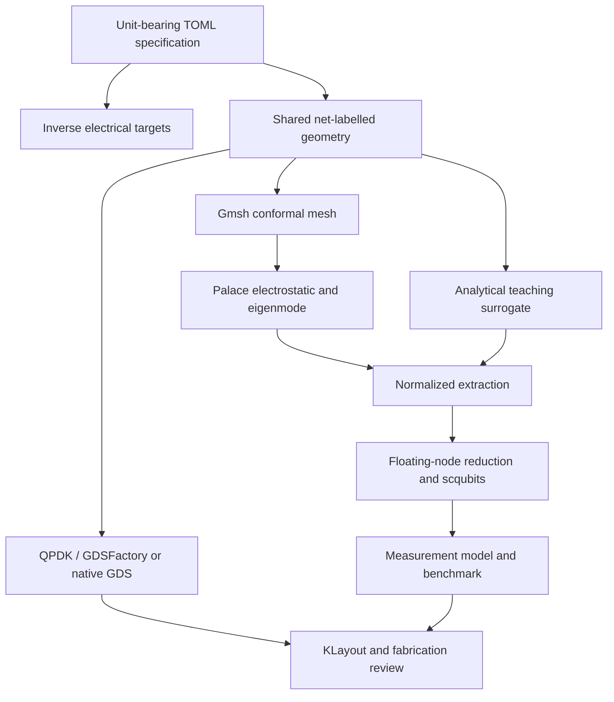

# Architecture and data contracts

## Modules

| Module | Contract and responsibility |
|---|---|
| `config.py` | TOML → validated, fully resolved dict; unknown keys rejected; units in keys |
| `geometry.py` | Physical device → exact axis-aligned rectangles grouped by electrical net |
| `cad.py` | Same geometry → deterministic native GDS or QPDK-owned pads plus GDSFactory assembly |
| `assembly.py` | Attach an explicitly supplied laboratory junction GDS with checksum, electrical and contact-anchor checks |
| `em.py` | Same rectangles → OCC fragment model, physical groups, conformal tetrahedral mesh and Palace JSON |
| `circuit.py` | Maxwell C + EJ → differential-mode Hamiltonian, spectrum, couplings and thermal quantities |
| `experiment.py` | Circuit output + stated loss/noise assumptions → synthetic measurement CSV and plots |
| `workflow.py` | Stage sequencing, fingerprints, failure recording, output manifests, comparison and tolerance runs |
| `provenance.py` | Recursive input/output checks and downstream invalidation after stage reruns |
| `qualification.py` | Independent P1 electrostatic reference and native meshes/configs for a capacitor/cavity Palace check |
| `cli.py` | Reproducible command-line access to stages and complete routes |

All modules are importable independently. Shared data is plain versioned JSON rather than hidden notebook state. Scientific internal arrays use SI where applicable, while public spectrum energies are E/h in GHz. Time-domain calculations use µs and angular rates in rad/µs.

## Geometry and masks

Coordinates are µm; GDS database precision is 1 nm. A coordinate arrangement performs exact rectangular Boolean differences and checks conductor isolation and connectedness. The union of all positive metal tiles is the lithographic base-metal mask. Each tile also has one electrical owner; that owner maps to a Palace boundary tag.

The QPDK adapter actually instantiates `double_pad_transmon` and uses it for the two capacitor pads. GDSFactory owns the resulting hierarchy, coarse leads, feedline, resonator and annotation assembly. The generic junction is replaced by a marker. No duplicated pad exposure is emitted. A KLayout Boolean XOR compares the entire exported positive-metal region with the shared geometry; a translation or reshaping with equal area is also rejected. The lightweight native writer provides the same intended base metal without importing GUI/CAD libraries. The QPDK/KLayout integration still requires execution with those dependencies installed.

The teaching router uses orthogonal segments and square corners. It is intentionally constrained to a layout envelope; unsupported lengths and overlaps fail. Smooth bends, multi-qubit routing, flux lines and process-specific airbridges are extensions, not features claimed by v0.2.

## Normalized extraction

Required keys are `schema_version`, `source`, `synthetic`, `node_order`, `matrix_fF`, `readout_GHz`, and `geometry_sha256`. The node order is exactly:

`[pad_a, pad_b, resonator, feedline]`

The matrix is the **Maxwell** capacitance matrix with positive diagonal, nonpositive mutual entries, symmetric positive definite and nonnegative row sums. Ground is eliminated as the voltage reference. Coarse leads are in the extraction; oxide/junction capacitance is **excluded** and added once in the circuit model.

Allowed provenance values:

| `source` | Meaning |
|---|---|
| `analytic_surrogate` | Explicitly uncalibrated geometric sensitivity model |
| `synthetic_fixture` | Synthetic imported data for workflow and parser demonstrations |
| `palace_fem` | Imported electrostatic and passive eigenmode solver outputs |

The FEM source describes where the data came from, not whether the simulation has converged. A recorded mode index identifies the user-reviewed readout mode. The linearized junction eigenmode output is not used as a bare cavity frequency.

## Stage behavior

`run` needs an empty output directory. `stage` reuses a run only if its resolved configuration fingerprint matches. Failed stages record the exception before exiting. Geometry content is checked against its hash; mismatched imported extraction is rejected. There is no implicit fallback from FEM to a surrogate.

Stages recompute when called; this release has no general incremental cache. After modifying configuration, use a new output directory. After intentionally changing stage code, restart the affected downstream stages and preserve the original run. Native solver meshes/configs/logs and version records should be archived together.

`stage_records` stores input/output hashes, selected backends and parent stages. Validation walks that dependency history recursively. Re-running an upstream stage marks existing descendants `stale` without deleting their files; those files cannot feed a new completed report until the required stages run again. A changed external extraction or raw Palace CSV is detected even if the geometry itself did not change. Source-code changes are not automatically inferred from a numeric artifact; after a code change rerun its producing stages in a new run.

`quantize` uses an existing current extraction unless explicitly overridden. `--force-surrogate` makes a deliberate switch visible and supersedes the earlier import; no failed solve is replaced implicitly. Completed native solves record their mesh/configuration and raw CSV hashes, and a zero exit without the expected output is treated as failure. `assemble-mask` checks that its layout and electrical parameters belong to current stages.

`sqw verify --run RUN_DIRECTORY` checks stage freshness and the final inventory. Relative input paths preserve portability when referenced files move with the repository; inputs outside the repository must remain accessible or be archived alongside the run. Old v0.1 runs lack this history and must be regenerated in a fresh v0.2 output directory.

`manifest.json` contains artifact hashes. It is an integrity inventory, not a digital signature or proof that another workstation reproduces every floating-point bit. GDS timestamps are fixed for deterministic native export; numeric tolerances apply to scientific comparisons.
