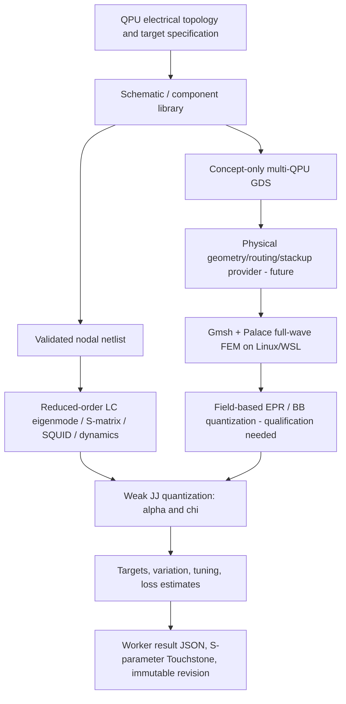

# Quantum Design Lab — architecture, physics, coverage and qualification

> **Scope:** SQE Studio extension for browser-based design of superconducting quantum circuits and QPU-level electrical models. Version **0.4.0 research preview**. Every implementation is open-source Python/JavaScript using the existing Apache-2.0 package. This is independent software; it does **not** contain, run, reproduce or redistribute Keysight/ADS source code, solver kernels, private algorithms, icons or visual assets.
>
> **Validated tier:** reduced-order/lumped models. **Not validated:** multi-qubit physical EM-driven layout-to-quantum extraction; full 3D on Windows; production foundry mask generation; professional ADS numerical equivalence. Never use conceptual design output for tape-out.

## 1. QuantumPro functional benchmark (documentation checked 2026-10-27)

Sources: [QuantumPro W3037E](https://www.keysight.com/zz/en/product/W3037E/pathwave-quantumpro.html), [Keysight QuantumPro 2024 introduction](https://www.keysight.com/se/en/about/newsroom/news-releases/2024/0227-pr24-036-keysight-introduces-quantumpro-delivering--first-i.html), [superconducting qubit design workflow](https://www.keysight.com/us/en/use-cases/design-superconducting-qubit-circuits.html), [parameter extraction](https://www.keysight.com/zz/en/use-cases/extract-quantum-parameters-from-layouts.html), [quantum EDA bundles](https://www.keysight.com.cn/cn/zh/resources-events-swdetails/en/lib/resources/miscellaneous/eda-software/quantum-eda.html), [APS 2026 3D packaging demonstration](https://meetings-archive.aps.org/smt/2026/mar-w15/14/). Feature claims about specific bundled editions must not be confused: W3037E QuantumPro and Quantum Ckt Sim/HB bundles are not the same SKU.

**Legend**: ✅ executable in this deliverable; ◇ original SQE engine with optional external native integration; △ limited reduced-order approximation; — **not** implemented. This matrix is meant to be candid, not marketing equivalence.

| Capability / design study | Status | Engine / reality |
|---|---|---|
| Browser-based projects, accounts, sharing, revisions, checkpoints, import/export | ✅ | Existing SQE Studio WSGI/SQLite/worker stack; tested API |
| One-Windows-machine browser + API + simulation worker | ✅* | Windows launcher and POSIX test; *Windows runtime acceptance pending* |
| Qubit/transmon netlist authoring and editable schematic graph | ✅ | C, L, R, JJ, effective-SQUID, 0 ground; SVG graph; nodes repositionable |
| 1/4/9/16 transmon QPU electrical templates | ✅ | Connected capacitive lattice with lumped resonators and two RF ports |
| Parameterized chip geometry, one transmon and readout | ◇ | Existing source's geometry, QPDK GDS, Gmsh/Palace hooks; native dependencies separately provisioned |
| QPU multi-qubit physical routing and fabrication-grade GDS | — | A **concept-only** placeholder GDSII is exportable; not topology-equivalent |
| Multi-layer / flip-chip / bump / via / cavity / package-aware 3D | — | Requires full geometry/mesher + 3D solver implementation |
| Lumped linear circuit eigenmode (LC) | ✅ | Generalized Hermitian eigenproblem, no field solve |
| Spectral mode labeling and JJ branch energy participation | △ | Lumped branch projection; **not distributed electromagnetic EPR** |
| Anharmonicity/self- and cross-Kerr χ matrix | △ | Weak Josephson quartic RWA, no full BB quantization or FEM-EPR |
| Linear multiport S(f) and Touchstone v1 export | ✅ | Nodal admittance/Kron elimination, ideal capacitive ports, reciprocal passive networks |
| Full-wave FEM eigenmode, electrostatics, field visualization | ◇ | Existing Gmsh → Palace provider for specific geometry; Linux/WSL/native provisioning required |
| Full-wave FEM driven frequency sweep / scattering | — | Palace can do driven EM, but no validated integrated Quantum Lab adapter here |
| MoM / Momentum equivalent | — | No own MoM solver; cannot call FDTD/FEM MoM |
| openEMS FDTD full-wave | — | Upstream Windows build exists, but integration absent |
| Kinetic inductance, temperature dependent Lk(T) and superconducting surface impedance | — | Defined as planned material-model integration, not generic `L` circuit component |
| Black-box quantization from full EM impedance/Y/Z | — | Requires multiport EM extraction and passivity/causality validation |
| FEM field-derived EPR with mode participation and dielectric/TLS loss | — | Palace exports can support later implementation, not reproduced by lumped phases |
| SQUID flux tuning | △ | Effective EJ(Φ), asymmetry; ignores finite loop inductance and phase bias solutions |
| SQUID / SNAIL / Snake / fluxonium Hamiltonians | — | Need multi-junction flux quantization, constraints and level diagonalization |
| QuTiP / scqubits full multilevel driven evolution | ◇ | Optional packages used in original single-device engine; new lab currently two-level Bloch only |
| Rabi, Ramsey, echo, T1 time-domain scenarios | △ | Integrated Bloch equations with T1/T2, no pulse transfer function or readout chain |
| General nonlinear harmonic balance, mixing, pump gain, X-parameters, JTWPA | — | One-mode **classical Duffing/Kerr** cubic is available as limited exploratory substitute |
| Linear EM/circuit co-simulation and powered response | — | Requires calibrated S-param embedding and nonlinear circuit solver |
| Process parameters, wafer plans, mask candidates, GDSII | ◇ | Original SQE Studio on one geometry; QPU GDS concept only |
| Lithography DRC / foundry sign-off | — | Process checks in original do not replace qualified foundry DRC |
| Target-driven optimization | △ | Bounded single-parameter EJ fit to frequency target; proposal, no automatic mask update |
| Yield / process spread / robust design | △ | Seeded independent lognormal EJ/C sampling, frequency-window yield; no correlated process model |
| Dielectric/conductor/radiation/quasiparticle loss budget | △ | User-supplied Q factors, not field-derived loss |
| Python scripting / reusable macros | ✅ | Existing reviewed/versioned trusted macros; worker code trusted (not sandbox) |
| Persistent jobs, quotas, cancellation, immutable artifacts | ✅ | Existing worker queue plus `mode=lab`; single host; Windows-compatible lock and process cancellation added |
| HPC/remote Linux workstation deployment | ◇ | Existing Docker/HTTPS/single-host web + worker; full multi-node dispatch not implemented |

## 2. Design-to-result flow



A new lab analysis does *not* run a synthetic Palace solve. It records `mode=lab`, a `lab:<analysis>` target, immutable revision ID, reviewed source version, Python environment and requested settings. The scheduler reserves a CPU and RAM slot, starts a subprocess and writes `jobs/<id>/lab/result.json` plus SHA-256; an S-parameter run also produces `network.sNp`. Files use the original project-authorized artifact endpoint and travel inside project export capsules. Jobs may be reviewed/consolidated only when their checksum matches. The pending multi-host adapter would preserve these job/result contracts while replacing local file + SQLite scheduling with an RPC worker/storage scheme.

## 3. Numerical models and conventions

**Units**: Capacitances fF, inductances nH, resistances Ω, `EJ/h` GHz, flux in Φ₀, output frequencies GHz, α/χ MHz, durations µs and S-parameters in dB. A single topological node labelled `0` is ground. Junction capacitance is represented by an explicit parallel C element; this *must* be included in an actual design budget.

### 3.1 Linear nodal eigenmodes

Each branch between nodes `a` and `b` is assembled using an incidence vector `b`: `C += Cbranch · b bᵀ`; `K += (1/Lbranch) · b bᵀ`; `G += (1/Rbranch) · b bᵀ`. Josephson inductance is `LJ = (Φ₀/2π)² / EJ` at the stable zero-phase point. Solve `K u = ω² C u` with `uᵀ C u = 1` via `scipy.linalg.eigh`. A singular C or K is rejected: no fake numeric eigenmode returned. Perfect metals and capacitors only; the port boundary is not part of the lossless eigenproblem.

SQUID effective symmetric/asymmetric Josephson energy: `EJ(Φ) = EJΣ sqrt(cos²(πΦ/Φ₀) + d² sin²(πΦ/Φ₀))`. The model assumes zero loop inductance, two-junction interference and stable local harmonic curvature. At Φ₀/2 with `d=0`, the linearized stiffness can vanish; singular models are reported as invalid, not regularized into fictitious qubit modes.

### 3.2 Kerr expansion

The branch zero-point flux and dimensionless phase are `Φzpf,jm = sqrt(ħ/(2ωm)) (bj · um)` and `φjm = (2π/Φ₀) Φzpf,jm`. Under a weak quartic perturbation of `−EJ cos φ` and a rotating-wave approximation:

- self-anharmonicity `αm / 2π [Hz] = −(1/2) Σj (EJj / h) φjm⁴`;
- cross-Kerr `χmn / 2π [Hz] = −Σj (EJj / h) φjm² φjn²`, `m ≠ n`;
- the reported **diagonal** χ entry is αm by convention; not twice αm.

The reported raw mode frequency is the linearized LC eigenfrequency. A qubit-assigned `frequency_ghz` is an *estimated f01* incorporating the first-order quartic vacuum correction `αm + (1/2)Σn≠m χmn`; this distinction is essential when comparing mode frequencies to measured qubit transitions.

The branch inductive energy fraction is `pjm = (bj · um)² / (LJj ωm²)`. In a full eigenmode solve, energy participation is field-integrated; branch participation here cannot predict interface losses or electric participation ratios. High excitation, flux-biased multi-junction circuits, dispersive multi-level shifts and transmon charge dispersion require higher-order numerical Hamiltonians.

### 3.3 S-parametric network

For each ω, `Yinternal = G + jωC + K/(jω)`; each port includes an ideal series coupling capacitor to its internal node. Internal nodes are eliminated by the Schur complement. With equal or individually specified real reference impedances `Z0`, `A = sqrt(Z0)·Yports·sqrt(Z0)` and `S = (I+A)⁻¹(I−A)`. The implementation emits amp/phase and Touchstone v1 with `# GHz S RI R 50` (or a uniform other reference); no misleading v1 export is emitted for unequal per-port impedances. Reciprocity/passivity of the reference LC network is regression-tested.

Distributed CPW modes, skin effects, kinetic inductance, normal/superconducting film surface impedance, port de-embedding and package modes are **absent**. Always compare against actual EM port data before hardware use.

### 3.4 Time, loss and uncertainty

The two-level Bloch rotating-wave equations apply externally declared T1/T2 (constraint `T2 <= 2 T1`) and idealized continuous drives. Rabi, Ramsey (phase-to-population readout), echo (ideal sign reversal) and T1 are supported. The population is not predicted from a real pulse generator/control stack.

The reduced Duffing equation `n[(κ/2)² + (Δ+Kn)²] = ε²` selects the smallest nonnegative real root for a power scan; when multiple roots exist they are counted, not classified stable or used to infer JPA gain/quantum noise. The Q budget uses user-supplied `1/Qtotal = Σ 1/Qi`, so `T1 = Qtotal/ω`; it does not claim any EM-derived decoherence mechanism.

The Monte Carlo tool applies independent *lognormal* component-level perturbations of JJ EJ and capacitor C, using an explicit seed and 10–500 samples, then computes how many satisfy per-qubit target windows. No foundry correlation, statistical TLS or frequency collision penalty is included. The optimizer performs a bounded scalar search over EJ for one assigned junction, returning a proposal; it never quietly modifies a checked-in design.

## 4. Existing native FEM and what Windows can actually run

The original code uses `sqw.em`, `sqw.workflow` and `sqw.studio` for a specific single-transmon field workflow. Python optional dependencies cover `gmsh`, `qpdk`, `scqubits`, `qutip`. The native Palace executable must be installed separately. [Palace](https://awslabs.github.io/palace/stable/) is Apache-2.0 and supports electrostatic/eigenmode/driven EM including full-wave field EPR; it does *not* officially ship or routinely test native Windows binaries. Using WSL2 (Linux inside Windows) is the realistic on-one-machine route for this engine. [openEMS](https://www.openems.de/) provides a Windows-capable FDTD solver (GPL-3.0-or-later); no adapter is claimed in this release. [Quantum Metal](https://qiskit-community.github.io/qiskit-metal/) is community-maintained, Apache-2.0 and headless; possible future geometry integration. Any license changes/compatibility of optional components must be reviewed before distribution or linking.

## 5. Design gap closure plan, prioritized

**P0 — qualification of this delivery (workstation):** execute `WINDOWS-FIRST-START.cmd` in clean Windows 11 x64 VM, test Python installer certificate, wheel availability, setup flow and Web UI end-to-end using Chromium/Edge, exercise job cancel, export/import and restart after interrupted job. Run regression suite, record hardware, Python freeze, solver versions and repeatability. Current delivery environment cannot complete Windows tests.

**P1 — geometry-circuit equivalence:** invent explicit multi-layer component + pin/edge schema for qubit islands, cross-caps, CPW resonators, bus, feedline, launch/airbridges, Josephson cells. Use QPDK/Quantum Metal + KLayout; assign deterministic net names, perform connectivity and lithography DRC, export GDS/mesh from the *same topology*. Until this is ready, the lab GDS is concept-only.

**P2 — native field solvers:** package WSL2/Docker Palace images with pinned source hashes, MPI/Gmsh version checks, material stackups, kinetic conductivity/surface impedance and converged electrostatic/eigenmode/driven problems. Build a test catalog (parallel plate, CPW, half-wave resonator, single and four qubit, package/cavity) with mesh-convergence and experimental comparisons. Consider separate FDTD openEMS and an actual BEM/MoM package, with **separate backend labels** rather than conflating discretizations.

**P3 — extraction and nonlinear circuit physics:** robust multiport Y/Z conversion, rational passive fitting and BB quantization; FEM field EPR and loss tangents; 3D packaging modes and Purcell design; multi-level scqubits/SQcircuit/QuTiP transient calibration, flux constraints, SNAIL/SQUID/fluxonium; nonlinear HB with multi-tone mixing and stability, JPA/JPC/TWPA models; convergence/tolerance error bars. These are independent substantial research software projects.

**P4 — system and HPC:** parameter sweeps, gradient/surrogate optimization, Bayesian uncertainty, wafer/process statistical decks, asynchronous graph workflows, user quotas, HPC dispatch via SLURM/PBS/Kubernetes, PostgreSQL, object storage, distributed locking and audited team administration. Preserve invariant: all scientific jobs are reproducible, backed by immutable inputs and tagged with a solver fidelity tier.

## 6. Reproducible local use and contract

```powershell
# Windows one-click (see docs/windows.md)
.\WINDOWS-FIRST-START.cmd

# Cross-platform (Python 3.11–3.13 with dependencies installed)
python scripts/start_studio.py

# Scientific and API regression tests
python -m unittest discover -s tests -v
```

Example Python API (project-free):

```python
from sqw.quantumlab import preset, analyze

design = preset(4)
modes = analyze(design, 'modes')
sparams = analyze(design, 'sparameters', {'start_ghz': 4, 'stop_ghz': 9, 'points': 101})
t1 = analyze(design, 'dynamics', {'sequence': 't1', 'duration_us': 50, 't1_us': 20})
proposal = analyze(design, 'optimize', {'qubit': 'Q0'})  # non-mutating
```

The UI saves the design in the existing project JSON key `quantum_lab`. Every simulation creates a new revision and submits a `mode=lab` job; result files are protected by normal project permission checks and exported in the capsule. For reproducibility, record a project capsule, result JSON, source git SHA/freeze, device materials and any independently verified fabrication geometry. A user can review `input.json`, `result.json`, `result.sha256` and worker logs to distinguish physical predictions from conceptual placeholders.
