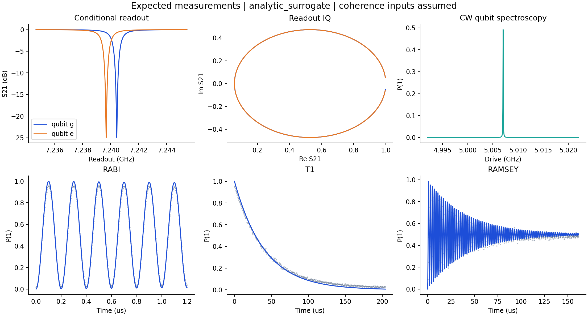

# Scientific engine and CLI reference

The scientific engine supplies **fully open-source superconducting quantum-chip design**, independently of the Studio browser interface. The reference chain is **Python / scqubits → QPDK / GDSFactory → Gmsh → Palace → Python analysis → KLayout / GDSII**.

The initial device is an aluminum, floating two-pad transmon with a half-wave CPW readout resonator and a two-port feedline, on high-resistivity silicon, at **20 mK**, with a **4–12 GHz** target band. One configuration connects the CAD, meshing, extraction, quantum model and expected measurements.

**Status: executable research scaffold, version 0.3.0.** The core demonstration, numerical tests and an independent reference-capacitor FEM calculation have been executed; the external QPDK/Gmsh/Palace stack still requires qualification on a workstation with those tools. The included GDSII is a fabrication **starting point**. Layer 91 marks a junction location; it is not a qualified junction mask. See [validation status](validation.md) and [fabrication handoff](fabrication.md).



## First start

Use Python **3.12** (3.11–3.13 supported as candidates), unzip/clone this repository, and run from its root:

```bash
python scripts/bootstrap.py
```

This creates `.venv`, installs the pinned core scientific environment and this editable package, checks dependencies, runs tests and generates `build/first-run/report.html`. No administrator rights are needed for Python setup. Installation requires access to PyPI. It never installs a FEM solver silently.

Activate the environment:

```bash
# Linux / macOS / WSL
source .venv/bin/activate
# Windows PowerShell
.venv\Scripts\Activate.ps1
```

Or use `.venv/bin/python -m sqw ...` directly (`.venv\Scripts\python.exe` on Windows).

Install the proposed reference Python stack with:

```bash
python scripts/bootstrap.py --profile full --skip-demo
sqw doctor
```

Palace, MPI and the KLayout desktop application are **native installations**, not virtual-environment packages. [Setup](setup.md) includes a pinned Palace source-build helper and Linux/WSL prerequisites. The full Python dependency resolution is recorded under `.sqw/full-resolved.txt`; qualify and preserve it before treating that environment as locked.

## Run the complete lightweight example

```bash
sqw run --config configs/demo.toml --mode demo --out build/demo
```

Open `build/demo/report.html`. The package produces:

| Artifact | Contents |
|---|---|
| `layout/device.gds` | Positive Al metal mask, launchers, resonator, pads, coarse JJ leads and annotations |
| `layout/geometry.json` | Shared net-labelled geometry in µm, connectivity and geometry hash |
| `em/*.json` | Palace electrostatic, bare and linearized eigenmode configurations |
| `specification.json` | Inverse electrical design from target frequency and anharmonicity |
| `parameters.json` | C, EJ, EC, Ic, LJ, f01, anharmonicity, g, chi, thermal populations, Purcell estimate |
| `experiment/*.csv` | Conditional readout S21, CW spectroscopy, Rabi, Ramsey and T1, including shot noise |
| `report.html` | Visual report linking layout and parameters |
| `run.json`, `manifest.json` | Stage status, input hash, dependency versions and artifact SHA-256 hashes |

The demo uses an **uncalibrated analytical capacitance surrogate**. It executes the data flow without external solvers and never labels a surrogate as a FEM result. Targets are goals; they are not substituted for forward-model results.

When the laboratory provides its qualified junction GDS, `sqw assemble-mask` attaches it using a process manifest with checksum, electrical targets and electrode contact anchors. See [fabrication handoff](fabrication.md); an example process manifest is included, with explicit placeholders rather than an invented laboratory process.

## Use the proposed tools

```bash
# QPDK pads / GDSFactory layout; scqubits and QuTiP cross-checks:
sqw run --cad-backend qpdk --quantum-backend scqubits \
  --dynamics-backend qutip --out build/reference-python

# Entire FEM route, AFTER identifying which passive mode is the readout:
sqw run --mode fem --cad-backend qpdk --quantum-backend scqubits \
  --dynamics-backend qutip --readout-mode 2 --ranks 4 --out build/fem
```

`2` is a command example, **not a known mode assignment**. See the [FEM walkthrough](fem.md) to generate fields first, identify the mode, import actual Palace output, converge meshes and assess package modes. Missing solvers and failed solves stop the FEM route; no fallback result is substituted.

## Work one module at a time

```bash
sqw stage spec --out build/staged
sqw stage layout --cad-backend native --out build/staged
sqw stage em-export --out build/staged
sqw stage quantize --out build/staged
sqw stage experiment --out build/staged
sqw stage report --out build/staged
```

Each stage can also be called from Python. Configuration fingerprints prevent accidental reuse of another device's run directory. `run` requires a fresh directory. [Architecture and data contracts](architecture.md) describe each interface.

Re-running an upstream stage marks existing dependent stages stale. `quantize` preserves a current imported extraction by default; `--force-surrogate` is required to replace it deliberately. Check a completed run with `sqw verify --run build/demo` before using its results. These checks validate file integrity and freshness, not physical accuracy.

## Qualify the numerical solvers

```bash
# No native tools required: actual SciPy P1 capacitor FEM, analytical cavity modes,
# and standalone meshes/configurations for an independent Palace comparison.
sqw qualify --out build/reference-problems

# On a workstation with Palace: execute both solves and compare results.
sqw qualify --solve --ranks 4 --out build/palace-qualification
```

The capacitor uses insulated sides and full end plates, so its exact solution is linear and has no fringing. The cavity checks a known PEC-box spectrum, including multiplicities. The command never labels an unexecuted Palace solve as passed. See [reference qualification](qualification.md).

## Examples and research workflows

| Start here | Purpose |
|---|---|
| [Getting started](tutorial.md) | Full core example, imported synthetic result, benchmark and tolerances |
| [Module examples](../examples/modules/README.md) | Short executable examples for each scientific module |
| [FEM workflow](fem.md) | Same geometry → Gmsh → Palace → normalized result → quantum model |
| [Numerical solver qualification](qualification.md) | Independent capacitor FEM and known cavity modes before interpreting chip simulations |
| [Physics and units](physics.md) | Equations, modal approximations, frequency and coherence conventions |
| [Reference-chip validation](benchmark.md) | Replace synthetic fixtures with the laboratory's measured chip |
| [Fabrication handoff](fabrication.md) | Layer polarity, junction process, DRC and review requirements |
| [Training and validation](training.md) | Optional research learning and validation exercises |
| [Sources](references.md) | Official software documentation and scientific references |

```bash
python -m unittest discover -s tests -v
sqw compare --parameters build/demo/parameters.json \
  --reference examples/data/synthetic_reference.csv --out build/comparison.json
sqw tolerance --samples 50 --out build/tolerance
```

No real reference-chip geometry, measurements, foundry rules or private correspondence are distributed. The example benchmark is explicitly synthetic.

## Publish to GitHub

Create an empty repository in your organization, then from this directory:

```bash
git init -b main
git add .
git commit -m "Add open superconducting qubit design workflow"
git remote add origin https://github.com/YOUR-ORG/open-superconducting-qubit-workflow.git
git push -u origin main
```

Keep private laboratory measurements in ignored `data/private/`. CI checks the core route on Python 3.11–3.13 and provides a manual candidate-reference-stack job. No CI pass is claimed until those jobs actually run.

Code is provided under [Apache-2.0](../LICENSE). Dependencies retain their own licenses. See [contributing](../CONTRIBUTING.md) for the expected review process.
