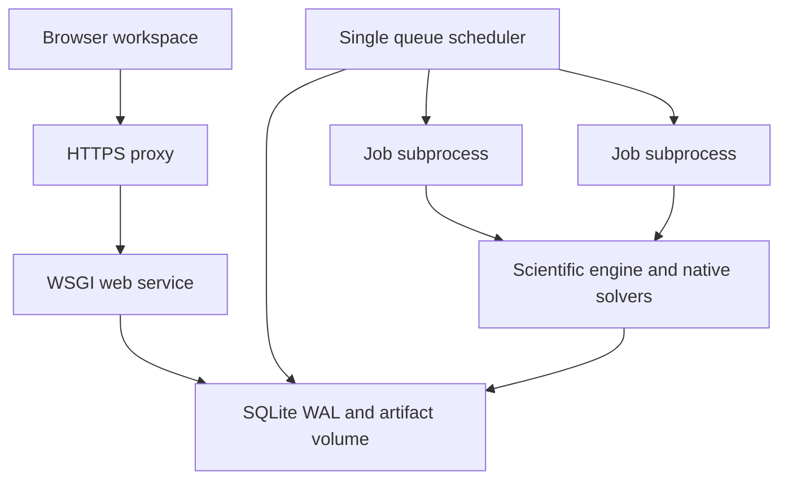

# Application architecture

The scientific `sqw` package remains independent of the web application. The `sqw.studio` package adds WSGI HTTP, persistent identity/projects, a durable queue, worker subprocesses and static browser assets.

## State and editing

SQLite transactions are short, use foreign keys, and run on a local disk. Separate web workers open separate connections. The editable project document has an optimistic version number: a stale save returns conflict rather than overwriting a colleague's changes. Revisions are immutable; restoration creates a new editable draft and leaves the history intact.

Users have global admin/researcher/viewer roles. Project owners manage editor/viewer memberships; administrators have explicit cross-project operator access. Sessions are server-side and authorization is checked again for artifacts, downloads and every mutation. See `SECURITY.md` for the tested boundaries and remaining deployment assumptions.

## Jobs and concurrency

Queue records survive browser and web-service restarts. One scheduler owns a local advisory lock. It claims queued jobs transactionally if concurrency, CPU and memory reservations fit. Each job runs as a separate Python process with its own immutable input snapshot, log and working directory. BLAS/OpenMP thread counts are set from the CPU/rank request. Different projects/revisions can therefore run concurrently without writing the same scientific run directory.

Reservations are admission controls, not measured memory limits or per-job cgroups. The worker service as a whole can be limited by the host/container. SQLite/local files are appropriate for this single-host design. Multi-host scheduling, SLURM/PBS adapters, PostgreSQL and distributed object storage remain extension work.

A job heartbeats independently of its numerical stage. Cancellation terminates its process group. Stale running records become interrupted; the worker checks changed state and does not silently continue as an untracked reservation. Graceful service shutdown requests termination. Exact MPI signal behavior still needs qualification with the actual native runtime.

## Selective reuse

A finalized job is a checkpoint, including jobs that failed after useful stages. Stage signatures use explicit parameter scopes, engine source/dependency identity and backend selection. The new job verifies retained artifacts, copies compatible outputs, records their origin and rewrites the run's configuration bookkeeping to the new revision only for retained stages whose scoped inputs are unchanged. This is declared reuse, not a claim that those stages executed again.

Changes to intrinsic T1 can retain the geometry/EM/quantum results. Changes to geometry or tool identity invalidate dependent work. Scopes are conservative: a change may recompute more than strictly necessary, but must not silently reuse a result whose known inputs changed. These dependency contracts must be updated with a new stage implementation.

Copying large native field folders can take time and storage; the initial version does not deduplicate multi-gigabyte workspaces. Native iterative solvers are not checkpointed internally by this application. A failed native stage restarts from its stage inputs, while completed predecessor stages can be retained.

## Process and project capsules

Process rules, accessory settings, asset IDs and notes are part of the project document and travel with revisions. Uploaded content is stored under generated IDs, with checksums and project authorization. Process candidates remain distinct from the EM conductor model and from fabrication approval.

Capsule export takes a consistent database read snapshot and includes immutable finalized workspaces. Active workspaces are omitted. Import creates new project/revision/job/asset identities and clears consolidation approval; executable macros are not activated from an archive. Uploads are spooled and unpacked on disk in bounded chunks. The importer validates identities, paths and asset checksums before publishing database state, and clears partial files on a failed publish. Capsules do not contain the user/session database. Keep the complete server database and artifact volume together in server backups.

## HTTP boundaries

`/api/auth/*` handles setup, activation and sessions; `/api/projects/*` handles drafts/revisions/assets/jobs/capsules; `/api/jobs/*` handles cancellation and consolidation; `/api/macros/*` manages reviewed code; `/api/source/*` exposes a fixed source allowlist. There is no general arbitrary-path file endpoint or user-controlled launcher command. Artifacts are resolved inside the authorized job workspace and HTML is sandboxed.

The browser polls active state and log tails. A WebSocket broker and front-end build pipeline are not required. Use Gunicorn and a reverse proxy for deployment; the standard-library loopback server is a local/tunnel convenience.
